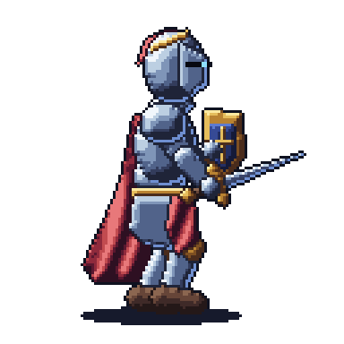
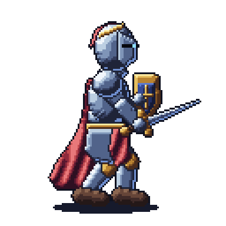
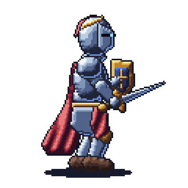
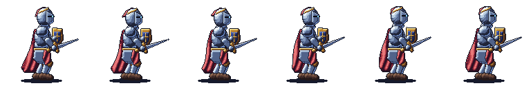
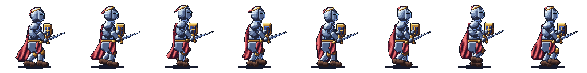
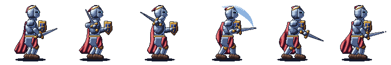
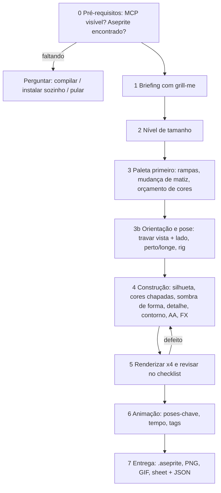

# OmniSprite 🎮✨

> **Pixel art grande, detalhada e com estilo definido, mais animações, direto no Aseprite — guiada por uma skill para agentes de IA.**
> 🇧🇷 **Projeto Brasileiro Open-Source** para quem cansou de sprites minúsculos, chapados e sem direção.

[](LICENSE)
[](#-projeto-brasileiro-open-source)
[](#-instalação)
[](https://github.com/willibrandon/pixel-mcp)
[](https://www.aseprite.org)

A OmniSprite ensina a IA um fluxo cirúrgico — **briefing → orientação → paleta → camadas → sombreamento → revisão → animação** — e controla o Aseprite pelo servidor MCP [`pixel-mcp`](https://github.com/willibrandon/pixel-mcp). Um único comando instala tudo e, se você não tem o Aseprite, a IA oferece baixar o código do GitHub e compilar para você.

| 😴 Idle (6 frames) | 🚶 Andar (8 frames) | ⚔️ Ataque (6 frames) |
|:---:|:---:|:---:|
|  |  |  |

*Cavaleiro 128×128 em estilo `hd-pixel`, vista lateral voltado para a direita, feito inteiramente pelo MCP a partir de um esqueleto (rig). Código e arquivos em [`examples/knight/`](examples/knight).*

Spritesheets (1×, horizontais, com metadados JSON):





> ⚠️ **Limitações do exemplo (sem maquiagem).** A capa fica na camada mais baixa, atrás do torso, mas em alguns frames a silhueta ainda parece atravessar o personagem na altura do cinto e das pernas; o próximo ajuste é estreitá-la e ancorá-la mais embaixo nas costas. As pernas se encostam em alguns frames do andar e o arco do golpe é fino. O exemplo demonstra o pipeline, não é um asset de jogo finalizado.

---

## 🇧🇷 Projeto Brasileiro Open-Source

A **OmniSprite** nasceu no Brasil para resolver um problema prático: IAs desenham sprites pequenos, sem estilo e, muitas vezes, misturando ângulos de câmera no mesmo personagem. Em vez de "pedir mais bonito", a skill muda o **processo**:

- **Tamanho de verdade:** níveis de resolução de 32×32 até cenas de 480×270, com 128×128 como padrão.
- **Direção travada:** uma vista e um lado para onde o personagem olha, definidos antes do primeiro pixel.
- **Paleta primeiro:** rampas de cor com mudança de matiz e orçamento de cores por tamanho.
- **Revisão visual obrigatória:** renderiza ampliado, olha o resultado e corrige o pior defeito.
- **Ecossistema aberto:** funciona com Claude Code e qualquer cliente MCP; compõe com a skill irmã [`omni-color`](https://github.com/LimaEdu-7x/omni-color).

---

## 🎯 O que é a OmniSprite?

Uma skill (`SKILL.md` + referências + scripts) que combina:

1. **🧭 Orientação e pose:** regras para travar a vista, o lado de olhar, quem fica na frente de quem e qual prop vai em qual mão ([`orientation-and-pose.md`](skills/omni-sprite/references/orientation-and-pose.md)).
2. **🎨 12 estilos prontos:** Game Boy, NES, SNES, GBA, arcade, HD pixel, dark fantasy, cyberpunk, chibi, isométrico, sem contorno (painterly) e 1-bit.
3. **📐 Níveis de tamanho:** de ícones 32×32 a cenas 480×270.
4. **🎞️ Animação por esqueleto:** ciclos de idle, andar, ataque e mais, com contagem de frames, tempos e IK de 2 ossos.
5. **🛠️ Plug and play:** instalador que baixa o `pixel-mcp` com checagem SHA-256 e, se faltar o Aseprite, oferece **compilá-lo para você**.
6. **🗣️ Entrevista com `grill-me`:** perguntas em rodadas, cada uma com resposta recomendada.

---

## 🚀 Fluxo de trabalho



### 📏 Níveis de tamanho

| Nível | Tela | Uso típico | Cores |
| :--- | :--- | :--- | :--- |
| S | 32×32 | itens, ícones | 8–16 |
| M | 64×64 | personagens pequenos, props | 16–24 |
| **L (padrão)** | **128×128** | personagens principais, props detalhados | 24–40 |
| XL | 192×192 / 256×256 | retratos de herói, chefes | 32–64 |
| Cena | 320×180 / 480×270 | cenários, key art | 32–64 |

### 🎨 Estilos

Game Boy 4 cores · NES 8-bit · SNES 16-bit · GBA chunky · arcade neo · **HD pixel (padrão)** · dark fantasy · cyberpunk neon · chibi fofo · isométrico · painterly sem contorno · 1-bit. Cada preset fixa tela, número de cores, contorno, degraus de sombra, dithering e antialiasing: [`styles.md`](skills/omni-sprite/references/styles.md).

### 🎞️ Animação

Receitas de frames e tempos para idle, andar, correr, pular, ataque, dano, morte e conjuração, mais a abordagem de esqueleto (balanço do quadril, trajetória dos pés em apoio/passada, IK de 2 ossos, atraso de fase da capa e do penacho): [`animation.md`](skills/omni-sprite/references/animation.md). Exporta GIF, PNG, spritesheet e JSON (tags e durações) para motores de jogo.

---

## ⚡ Como usar

Basta pedir. A skill é acionada por pedidos de sprite, tile, ícone, pixel art, spritesheet ou animação.

```text
omni-sprite: cavaleiro dark fantasy 128×128, vista lateral, com idle e andar
Crie um conjunto de poções 64×64 em estilo SNES 16-bit com a paleta pico-8
Transforme esta imagem de referência em um personagem 96×96 estilo GBA
```

A IA começa com uma rodada curta de `grill-me` (perguntas independentes juntas, cada uma com resposta recomendada, para você só dizer "sim"): o que é, vista/câmera, estilo, tamanho, animação e paleta. Depois desenha.

---

## 📦 Instalação

### 1. Um comando (recomendado)

```powershell
# Windows (PowerShell)
.\install.ps1                                  # detecta o Aseprite sozinho
.\install.ps1 -AsepritePath "C:\caminho\aseprite.exe"
```
```bash
# macOS / Linux
./install.sh                                   # ou ./install.sh /caminho/aseprite
```

O instalador copia `skills/*` para `~/.claude/skills`, baixa uma versão fixa do `pixel-mcp`, **confere o SHA-256**, grava a configuração e registra o servidor (`claude mcp add --scope user aseprite …`). Reinicie o cliente e confirme com `claude mcp list` que `aseprite` aparece.

Requisitos: Aseprite 1.3.10+ (não incluído) · Claude Code (ou outro cliente MCP; adapte o registro) · Python 3 só para o script auxiliar e o exemplo.

### 2. Instalação manual

```bash
# Claude Code
mkdir -p ~/.claude/skills && cp -r skills/omni-sprite skills/grill-me ~/.claude/skills/

# Antigravity / Gemini CLI
mkdir -p ~/.gemini/config/skills && cp -r skills/omni-sprite skills/grill-me ~/.gemini/config/skills/
```

### 3. 🕹️ Não tem Aseprite?

As skills instalam do mesmo jeito. No primeiro pedido, a IA pergunta o que você prefere:

1. **Compilar para mim** — clona o código do Aseprite, baixa o Skia pré-compilado correto e compila com CMake/Ninja (`build-aseprite.ps1` / `.sh`; 10–40 min, 3–5 GB).
2. **Eu instalo sozinho** — Steam, itch.io ou aseprite.org (pago; apoia o desenvolvedor).
3. **Pular o Aseprite** — desenhar com Python/Pillow usando as mesmas regras de estilo (sem arquivo `.aseprite`).

> O Aseprite é *source-available* sob EULA própria: compilar para uso pessoal é permitido, redistribuir o binário não. Os scripts de compilação seguem o procedimento documentado do Aseprite e **não foram executados de ponta a ponta em todas as plataformas**; o `INSTALL.md` do código clonado é a referência se algum passo falhar. Detalhes: [`build-aseprite.md`](skills/omni-sprite/references/build-aseprite.md).

---

## 🧪 Armadilhas verificadas do `pixel-mcp` (v0.5.0)

- Use **barras normais** em `output_path`; barras invertidas quebram o Lua gerado (`\U` vira escape).
- `create_canvas` devolve `{"file_path": …}`; esse é o `sprite_path` de todas as outras ferramentas.
- `scale_sprite` altera o arquivo no lugar: faça `save_as` de uma cópia antes.
- Números de frame começam em 1; `export_sprite` com frame 0 = todos os frames.
- Falar com o servidor por stdio exige JSON por linha terminada em `\n` (CRLF falha).

---

## 🗂️ Estrutura do repositório

```text
install.ps1 / install.sh              instalação em um comando
skills/
  omni-sprite/                        SKILL.md + references/ + scripts/
  grill-me/                           skill de entrevista incluída (Matt Pocock, MIT, em inglês, sem alterações)
examples/knight/                      rig.py, make_anims.py, mcp_client.py, out/ (.aseprite, GIF, sheets, JSON)
THIRD_PARTY_NOTICES.md  LICENSE
```

As referências listam 12 sites de aprendizado/paleta e 21 skills e servidores da comunidade para estudar; todos mantêm suas licenças e nenhum é distribuído aqui.

## ⚠️ Limitações

Desenhar por chamadas de ferramenta é lento e o modelo não enxerga a tela sem exportar, então a skill usa formas, esqueletos, o método da grade (`grid_to_pixels.py`) e o ciclo de revisão. URLs e notas de skills de terceiros vêm de buscas na web e devem ser verificadas antes de confiar. Versão inicial.

---

## 🏆 Créditos & Referências

- **[Matt Pocock — skill grilling / grill-me](https://github.com/mattpocock/skills)** — © 2026, MIT. Incluída sem alterações em `skills/grill-me/`.
- **[pixel-mcp](https://github.com/willibrandon/pixel-mcp)** — de Brandon Williams (willibrandon), MIT. Baixado na instalação, não redistribuído.
- **[Aseprite](https://www.aseprite.org)** — Igara Studio / David Capello. Não incluído.
- **[Lospec](https://lospec.com)**, **[SLYNYRD Pixelblog](https://www.slynyrd.com/blog)**, **[Saint11](https://saint11.art/blog/pixel-art-tutorials/)**, **[Derek Yu](https://derekyu.com/makegames/pixelart.html)** — estudo de paletas, sombreamento e animação.
- Avisos completos: [`THIRD_PARTY_NOTICES.md`](THIRD_PARTY_NOTICES.md).

---

## 📄 Licença

Distribuído sob a licença **MIT**. Veja [`LICENSE`](LICENSE).
Feito com 💚 e 💛 no Brasil por [LimaEdu-7x](https://github.com/LimaEdu-7x).
